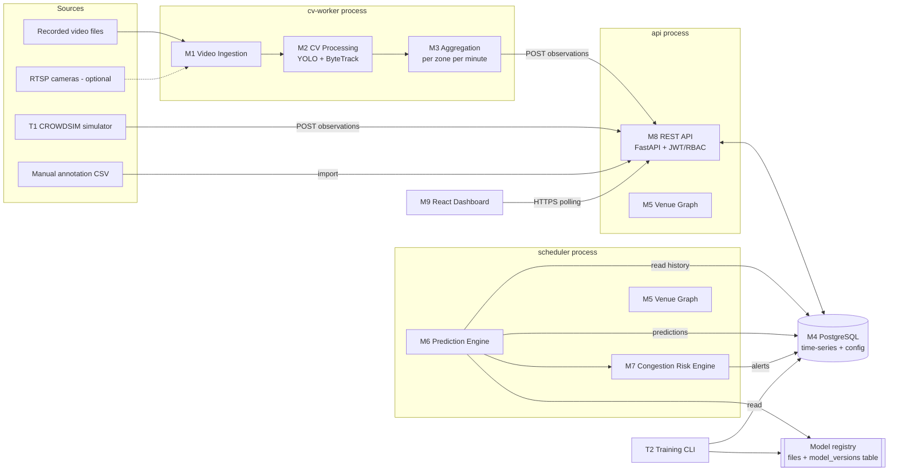

# 07 — System Architecture

| Field | Value |
|---|---|
| Version | 0.2 |
| Status | Implemented in the solo scope. **§9 lists where the implementation differs from §1–§8 and wins over them** |
| Diagrams | [ARCHITECTURE/](../ARCHITECTURE/) (`.mmd` sources) |

---

> §1–§8 are the original design for a 4-person team with a GPU. The modules M1–M9, the single ingestion contract (AD-02), polling (AD-03) and the information flow in §4 are implemented as designed. The runtime (processes, scheduler, detector, authentication) changed: see §9.

## 1. Architectural style

### Decision AD-01 — Modular monolith with three runtime processes

| Item | Content |
|---|---|
| Selected | One Python code base (`crowdcast/`) organised as modules M1–M9 with explicit interfaces, deployed as **three processes** from the same image — `api`, `scheduler`, `cv-worker` — plus PostgreSQL and a static frontend |
| Alternatives | (a) Single process for everything; (b) microservices with a message broker (Kafka/RabbitMQ); (c) serverless |
| Reason | CV inference is CPU/GPU-heavy and must not block API requests, and the prediction cycle must run on a timer independent of HTTP traffic — hence separate *processes*. But they share one code base, one database and one deployment, avoiding broker and service-discovery overhead that a 3–4 person team cannot maintain in 8 weeks |
| Trade-offs | Processes share the database as integration point (coupling through schema); horizontal scaling beyond one venue is not addressed. Acceptable for the prototype scale (NFR-SCL-01) |

### Decision AD-02 — The API is the single ingestion contract

All observation producers — the CV worker, the synthetic simulator (CROWDSIM), and the CSV annotation importer — submit data through `POST /api/crowd/observations`. **Consequence:** the forecasting pipeline cannot tell whether data came from cameras or simulation except through the explicit `data_origin` field, so a demo can run identically on synthetic streams when footage is unavailable.

### Decision AD-03 — Polling, not push, for the dashboard (initially)

The dashboard polls every 5–10 s (TanStack Query). Server-Sent Events are a *Should* upgrade. Polling meets FR-DSH-04 (≤ 10 s) and FR-ALR-05 (≤ 15 s) and is simpler to test.

---

## 2. Components

| ID | Component | Runs in | Responsibility | Key technology |
|---|---|---|---|---|
| M1 | Video Ingestion | `cv-worker` | Open files/RTSP, sample frames at target FPS, attach timestamps mapped to event time | OpenCV `VideoCapture` |
| M2 | CV Processing | `cv-worker` | Person detection, tracking, per-region counts, line crossings | Ultralytics YOLO11, ByteTrack, `supervision` |
| M3 | Crowd Data Aggregation | `cv-worker` | Turn frame-level outputs into per-zone per-minute observations; post to API | NumPy |
| M4 | Time-Series Storage | PostgreSQL + repository layer in `api`/`scheduler` | Persist observations, predictions, alerts; time-range queries | PostgreSQL 16, SQLAlchemy 2, Alembic |
| M5 | Venue Graph | library used by `api` and `scheduler` | Zones, connections, adjacency, neighbour feature helpers, validation | NetworkX |
| M6 | Prediction Engine | `scheduler` (online) + CLI (offline training) | Feature building, model inference, fallback, model registry | pandas, XGBoost, scikit-learn, (PyTorch for LSTM) |
| M7 | Congestion Risk Engine | `scheduler` | Levels, risk score, alert lifecycle with hysteresis | Pure Python |
| M8 | Backend API | `api` | REST endpoints, auth, RBAC, validation | FastAPI, Pydantic v2, PyJWT, argon2-cffi |
| M9 | Frontend Dashboard | browser (static files via nginx) | Pages in [15](15_FRONTEND_SPECIFICATION.md) | React 18, TypeScript, Vite, TanStack Query, Recharts, Tailwind |
| T1 | CROWDSIM (tool) | CLI | Synthetic event generation and replay | Python, NumPy |
| T2 | Training & evaluation (tool) | CLI | Dataset building, training, ablations, reports | Python, XGBoost, Optuna |

## 3. Architecture diagram



## 4. Information flow

### 4.1 Perception path (every frame → every minute)

1. **M1** reads frames, keeps every $k$-th frame to reach the target processing rate (default 5 FPS), and stamps each with `event_time = start_offset + frame_index / source_fps`.
2. **M2** detects persons, updates ByteTrack, computes each track's **foot point** (bottom-centre of the box), tests it against zone-region polygons, and tests track segments against counting lines.
3. **M3** maintains per-zone accumulators for the current minute: per-frame occupancy samples, crossing counts per direction, speed samples. At each minute boundary it emits one observation per zone ([09 §8](09_COMPUTER_VISION_METHODOLOGY.md)) and posts the batch to M8.

### 4.2 Storage path

4. **M8** validates the batch (zones belong to the event, counts non-negative, bucket aligned to minute) and upserts into `crowd_observations` (M4).

### 4.3 Prediction path (every 60 s)

5. **Scheduler** triggers at second 10 of each minute (allowing late observations to arrive).
6. **M6** loads the last 60 minutes of observations for all zones, the schedule, and the venue graph (M5); builds the feature matrix; runs the active model for each horizon and quantile; writes predictions. On error or insufficient history it writes persistence predictions flagged `is_fallback`.
7. **M7** maps current and predicted occupancy to levels, updates the alert state machine, and writes/updates `congestion_alerts`.

### 4.4 Presentation path

8. **M9** polls `GET /api/crowd/current/{event_id}`, `GET /api/predictions/{event_id}` and `GET /api/alerts/{event_id}` and renders the live map, forecast timeline and alerts.

Sequence and data-flow diagrams: [ARCHITECTURE/data_flow.mmd](../ARCHITECTURE/data_flow.mmd).

## 5. Timing budget (per minute)

| Step | Budget | Note |
|---|---|---|
| Minute boundary → observation posted | ≤ 5 s | M3 flush |
| API upsert | ≤ 1 s | Batch insert |
| Scheduler start offset | +10 s after boundary | Grace period for late data |
| Prediction cycle | ≤ 5 s | NFR-PERF-01 |
| Dashboard poll interval | ≤ 5 s average wait (10 s poll) | |
| **Total freshness** | **≤ 20 s typical** | NFR-PERF-04 |

## 6. Technology decisions

| ID | Decision | Alternatives | Reason | Trade-off |
|---|---|---|---|---|
| AD-04 | **Python 3.11 + FastAPI** backend | Django REST, Flask, Node.js | Same language as CV/ML; async; automatic OpenAPI docs; Pydantic validation | Less "batteries-included" admin than Django |
| AD-05 | **PostgreSQL 16** (plain, time-indexed tables) | TimescaleDB, InfluxDB, SQLite | Required by brief; relational config + time series in one DB; data volume (~10⁶ rows) is small | No automatic retention/compression — implemented as a job. TimescaleDB can be enabled later without schema change |
| AD-06 | **YOLO11 (Ultralytics) + ByteTrack** | YOLOX (Apache-2.0), RT-DETR, Faster R-CNN; DeepSORT | Mature tooling, pretrained COCO person class, built-in trackers; ByteTrack needs no appearance model | AGPL-3.0 licence: our code must be released under a compatible licence if distributed; YOLOX is the fallback if this is unacceptable |
| AD-07 | **XGBoost (quantile)** as main forecaster | LightGBM, Random Forest, LSTM, GNN | Strong on tabular lag features with modest data; quantile objective; fast inference | Cannot extrapolate beyond training range → mitigated by delta target ([10 §6](10_ML_FORECASTING_METHODOLOGY.md)) |
| AD-08 | **React + TypeScript + Vite** frontend | Streamlit, Dash, Vue | Required for a polished multi-page dashboard; typed API client generated from OpenAPI | More effort than Streamlit; mitigated by component library |
| AD-09 | **SVG floor-plan map**, not GIS map | Leaflet/OpenStreetMap | Venues are small, indoor/outdoor plans; zone polygons in plan coordinates | No geo-coordinates (not needed) |
| AD-10 | **APScheduler** in a dedicated process | Celery + Redis, cron | No extra broker; 1-min cadence is trivial | Single-instance scheduler (acceptable) |
| AD-11 | **Docker Compose** deployment | Bare-metal scripts, Kubernetes | Reproducible on team laptops | Docker Desktop on Windows needs WSL2 |

## 7. Code base layout (planned)

```
crowdcast/
  backend/
    crowdcast/
      ingestion/        # M1
      vision/           # M2
      aggregation/      # M3
      storage/          # M4 repositories, models, migrations
      venue_graph/      # M5
      forecasting/      # M6 (features, models, registry, cycle)
      risk/             # M7
      api/              # M8 routers, schemas, auth
      common/           # config, logging, time utilities
    tools/
      crowdsim/         # T1
      training/         # T2
    tests/
  frontend/             # M9
  docker-compose.yml
```

Each module exposes an `interfaces.py`; `import-linter` contracts forbid importing another module's internals (NFR-MOD-01).

## 8. Architectural risks

| Risk | Mitigation |
|---|---|
| GPU unavailable on demo machine | Pre-process footage offline; replay observations from DB/CSV through the same API |
| Database becomes a bottleneck | Not expected at ≤ 15 zones; indices in [13](13_DATABASE_DESIGN.md) |
| Clock mismatch between video and event time | Event time derived from configured start offset, never from wall-clock for recorded files |
| Scheduler and API diverge in configuration | Both read the same `.env` and DB; one Docker image |

## 9. Solo implementation (v0.2, 9.4 audit)

Scope decisions are in [WORKFLOW.md](../WORKFLOW.md) (D1–D8, Deviation log). Where this section and §1–§8 differ, this section wins.

| Topic | Design (§1–§8) | Implemented |
|---|---|---|
| AD-01 processes | Three processes (`api`, `scheduler`, `cv-worker`) from one Docker image, plus PostgreSQL and a static frontend | Still a modular monolith, but only PostgreSQL runs in Docker. Python runs natively: one API process (uvicorn), a CLI cycle driver (`tools.run_predictions`), and CLI observation sources (`tools.crowdsim.replay`, `tools.vision.run_camera`). See [18 §2](18_DEPLOYMENT_PLAN.md) |
| §4.3, AD-10 scheduler | APScheduler process, cycle at second 10 of each minute | No scheduler. The cycle driver back-fills an event, or with `--follow` polls and issues one cycle per newly completed minute bucket, in **event time** taken from the data ([10 §12](10_ML_FORECASTING_METHODOLOGY.md)). Replays at any speed give identical predictions |
| M1–M3 placement | Inside the `cv-worker` process, near real time on a GPU | Offline on recorded public clips on the CPU (`tools.vision.run_camera`), posting minute rows through the API (AD-02 unchanged). The demo replays stored observations |
| M2, AD-06 detector and tracker | Ultralytics YOLO11 + ByteTrack via `supervision` | YOLOX (Apache-2.0) through ONNX Runtime with tiled detection; ByteTrack implemented in `vision/tracking.py` (D2; Deviation log 2026-11-20/21). Method: [09](09_COMPUTER_VISION_METHODOLOGY.md) |
| M1 code location | `ingestion/` (§7) | Frame reading is `vision/frames.py`. `ingestion/` holds the observation contract and its validation, used by the API |
| M8 auth | JWT, RBAC (PyJWT, argon2-cffi) | None (D7): single local user, no login. Listed as a limitation |
| M9 serving | Static build behind nginx | Vite development server proxying `/api` to the API |
| AD-04 language | Python 3.11 | Python 3.12 (uv-managed, D8) |
| AD-11 deployment | Docker Compose for all services | Docker Compose for PostgreSQL only |
| §5 timing budget | Freshness ≤ 20 s with a 10-s scheduler offset | The prediction-cycle step (≤ 5 s, NFR-PERF-01) is measured by `tools.bench_cycle` (logged in EXPERIMENT_LOG.md). The other steps have no separate scheduler offset in the event-time design |
| §7 module boundaries | Enforced by `import-linter` contracts | Enforced by `backend/tests/test_module_boundaries.py`: a module imports another only through its `interfaces.py` (`common/` is shared; CLI tools in `tools/` are exempt). Every module except `api` has an `interfaces.py` |
| §7 layout | As listed | As listed, plus `.github/workflows/ci.yml` (lint, types, tests with a PostgreSQL service, API-client drift check, frontend checks, privacy scan) |
| §8 risk "GPU unavailable" | Mitigation planned | Occurred (R6): CPU-only offline CV is the main path |
