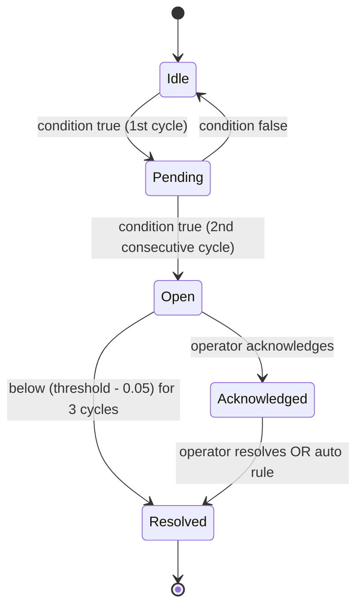
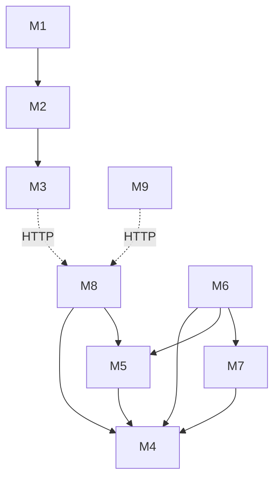

# 08 — Module Design

| Field | Value |
|---|---|
| Version | 0.1 |
| Status | Proposed — interfaces are design contracts, not implemented code |

Interface signatures below are written in Python-style pseudocode to fix names and types. They are design contracts; implementation may refine them but must keep the data contracts consistent with [13](13_DATABASE_DESIGN.md) and [14](14_API_SPECIFICATION.md).

---

## M1 — Video Ingestion

| Item | Content |
|---|---|
| Responsibility | Read frames from a camera source, down-sample, timestamp |
| Inputs | `CameraSource` config (from `GET /api/cameras/{id}/config`): URI, `source_fps` override, `target_fps`, `event_time_offset` |
| Outputs | Stream of `Frame(camera_id, event_time: datetime, image: ndarray)` |
| Requirements | FR-VID-01…05 |

```text
class FrameSource(Protocol):
    def frames(self) -> Iterator[Frame]        # blocking generator
    def close(self) -> None

FileFrameSource(uri, target_fps, start_event_time, realtime: bool)
RtspFrameSource(uri, target_fps)               # Could-priority
```

Behaviour:
- Frame stride $k = \max(1, \text{round}(\text{source\_fps} / \text{target\_fps}))$.
- `event_time = start_event_time + frame_index / source_fps` for files (deterministic); wall-clock for RTSP.
- `realtime=True` sleeps to emulate live playback (demo); `False` processes as fast as possible (batch evaluation).
- Each camera runs in its own OS process (Python `multiprocessing`) so a crash affects only that stream (NFR-REL-01).

## M2 — CV Processing

| Item | Content |
|---|---|
| Responsibility | Detect persons, track, test regions and lines |
| Inputs | `Frame`; camera geometry: list of `ZoneRegion(zone_id, polygon_px, is_primary)` and `CountingLine(line_id, connection_id, p1, p2, positive_direction_zone_id)` |
| Outputs | `FrameResult(camera_id, event_time, region_counts: dict[zone_id,int], crossings: list[Crossing], speeds_px: list[float], mean_box_height_px, detection_count)` |
| Requirements | FR-CV-01…06 |

```text
class PersonDetector(Protocol):
    def detect(self, image) -> Detections          # boxes, scores (class=person only)

class Tracker(Protocol):
    def update(self, dets: Detections) -> Tracks    # track_id, box

class GeometryEvaluator:
    def region_counts(self, tracks) -> dict[int, int]
    def crossings(self, tracks, prev_positions) -> list[Crossing]
```

Defaults: `yolo11n.pt`, `imgsz=640`, `conf=0.25`, class filter `person`; ByteTrack via Ultralytics/`supervision` with `track_buffer=30` frames. Track IDs and positions live only in process memory (NFR-PRV-02). Method details: [09](09_COMPUTER_VISION_METHODOLOGY.md).

## M3 — Crowd Data Aggregation

| Item | Content |
|---|---|
| Responsibility | Combine `FrameResult`s from all cameras into one observation per zone per minute |
| Inputs | `FrameResult` stream; zone→camera mapping |
| Outputs | `ObservationIn` list posted to `POST /api/crowd/observations` |
| Requirements | FR-OBS-01…03, FR-CV-05 |

Aggregation rules (bucket $[t, t+60\,\text{s})$):

| Field | Rule |
|---|---|
| `occupancy` | Median over frames of the primary camera's region count, divided by the region's `coverage_fraction` (default 1.0), rounded |
| `occupancy_raw` | Median without coverage correction (kept for analysis) |
| `inflow` | Sum of crossings into the zone across all lines bounding it |
| `outflow` | Sum of crossings out of the zone |
| `mean_speed_mps` | Mean track speed in m/s if the camera has a homography, else `null` |
| `quality` | `OK`; `LOW_CONFIDENCE` if > 30 % of frames flagged dense; `PARTIAL` if < 50 % of expected frames received; `MISSING` if none |
| `method` | `DETECTION` or `DENSITY_MAP` |

The median (rather than mean) reduces the effect of transient detection failures. Posting is retried with exponential back-off; unsent batches are buffered to a local JSONL file (≤ 24 h).

## M4 — Time-Series Storage

| Item | Content |
|---|---|
| Responsibility | Persistence and query of configuration, observations, predictions, alerts |
| Interface | Repository classes; no SQL outside M4 |
| Requirements | FR-OBS-*, NFR-SCL-*, NFR-MNT-03 |

```text
class ObservationRepo:
    def upsert_batch(self, rows: list[ObservationIn]) -> UpsertResult
    def window(self, event_id, start, end, origin=None) -> DataFrame   # zone_id x bucket
    def latest(self, event_id) -> list[Observation]
class PredictionRepo:
    def insert_cycle(self, rows: list[PredictionRow]) -> None
    def latest_by_zone(self, event_id) -> list[PredictionRow]
    def for_target_range(self, event_id, zone_id, start, end, horizon) -> list[PredictionRow]
class AlertRepo: ...
```

Schema: [13](13_DATABASE_DESIGN.md).

## M5 — Venue Graph

| Item | Content |
|---|---|
| Responsibility | Build and validate $G=(V,E)$; provide adjacency and neighbour aggregates |
| Inputs | Zones and connections from M4 |
| Outputs | `VenueGraph` object (immutable per cycle) |
| Requirements | FR-ZON-03…05 |

```text
class VenueGraph:
    zones: dict[int, Zone]
    def neighbours(self, zone_id, direction="in"|"out"|"both") -> list[int]
    def adjacency(self, weighted: bool = False) -> ndarray          # |V| x |V|
    def travel_time_s(self, i, j) -> float
    def validate(self) -> list[GraphIssue]                          # isolated, unreachable
    def shortest_path(self, src, dst, cost_fn) -> list[int]         # future: routing
```

Mathematical definitions: [11](11_SPATIAL_INTELLIGENCE.md).

## M6 — Prediction Engine

| Item | Content |
|---|---|
| Responsibility | Online prediction cycle; offline training; model registry |
| Inputs | 60-min observation window, schedule items, `VenueGraph`, active `ModelVersion` |
| Outputs | `PredictionRow(event_id, zone_id, issued_at, horizon_min, target_time, p10, p50, p90, model_version_id, is_fallback)` |
| Requirements | FR-FC-01…06, NFR-PERF-01, NFR-REL-02 |

```text
class FeatureBuilder:
    def build(self, obs_window, schedule, graph, t, feature_set) -> DataFrame   # one row per zone

class Forecaster(Protocol):
    horizons: tuple[int, ...]           # (5, 15, 30)
    def predict(self, X: DataFrame) -> dict[int, QuantilePrediction]

class PersistenceForecaster(Forecaster) ...
class MovingAverageForecaster(Forecaster) ...
class ConservationForecaster(Forecaster) ...
class XGBQuantileForecaster(Forecaster) ...   # 3 horizons x 3 quantiles = 9 boosters
class LSTMForecaster(Forecaster) ...          # Should
class GraphForecaster(Forecaster) ...         # Could

def run_cycle(event_id, now) -> CycleReport
```

**The same `FeatureBuilder` is used offline and online** — this is the main defence against training/serving skew. Model artefacts are stored as files under `models/<version>/` with a `manifest.json` (feature set, horizons, training data hash, metrics, git commit). Method: [10](10_ML_FORECASTING_METHODOLOGY.md).

## M7 — Congestion Risk Engine

| Item | Content |
|---|---|
| Responsibility | Levels, risk scores, alert state machine |
| Inputs | Latest observations, new predictions, zone thresholds |
| Outputs | Level per zone/horizon; alert inserts/updates |
| Requirements | FR-CNG-*, FR-ALR-* |

**Level function** with thresholds $\theta = (\theta_E, \theta_H, \theta_C)$ (defaults 0.60, 0.80, 0.95):

$$
L(u) = \begin{cases}
\text{NORMAL} & u < \theta_E\\
\text{ELEVATED} & \theta_E \le u < \theta_H\\
\text{HIGH} & \theta_H \le u < \theta_C\\
\text{CRITICAL} & u \ge \theta_C
\end{cases}
$$

**Risk score** for zone $i$, horizon $h$ (used for sorting zones in the UI):

$$
r_{i,h} = \min\Big(1,\; \max\big(0,\; \tfrac{\hat u^{50}_{i,h} - \theta_E}{\theta_C - \theta_E}\big)\cdot (1-\lambda) + \lambda \cdot \mathbb{1}[\hat u^{90}_{i,h} \ge \theta_H]\Big),\quad \lambda = 0.25
$$

i.e. mostly driven by the median forecast, with a bonus when the upper quantile reaches HIGH. $\lambda$ is a UI-ranking parameter, not a learned quantity.

**Alert state machine** (per event, zone, type ∈ {`CURRENT`, `PREDICTED`}):



- `PREDICTED` condition: $L(\hat u^{50}_{i,h}) \ge \text{HIGH}$ for **any** horizon; the alert records the **smallest** such horizon and the predicted onset time $t + h$.
- `CURRENT` condition: $L(u_i(t)) \ge \text{HIGH}$; opens after **one** cycle (no pending state) — current congestion should not be delayed.
- Severity of an open alert is updated (escalated) if the level rises to CRITICAL; escalation is logged.

## M8 — Backend API

| Item | Content |
|---|---|
| Responsibility | HTTP interface, authentication, authorisation, validation |
| Requirements | FR-AUTH-*, FR-EVT-*, FR-VEN-*, FR-ZON-*, NFR-SEC-* |
| Structure | Routers per resource; Pydantic request/response schemas; dependency `require_role(...)`; error handler producing the standard error envelope |

Specification: [14](14_API_SPECIFICATION.md).

## M9 — Frontend Dashboard

| Item | Content |
|---|---|
| Responsibility | Operator and organiser UI |
| Requirements | FR-DSH-* |
| Structure | Route-level pages, shared components (`VenueMap`, `ZoneCard`, `ForecastChart`, `AlertList`, `LevelBadge`), API client generated from OpenAPI (`openapi-typescript`) |

Specification: [15](15_FRONTEND_SPECIFICATION.md).

## T1 — CROWDSIM (synthetic generator)

Generates per-minute ground-truth zone states for synthetic events and posts them as `SYNTHETIC` observations, optionally with a CV-like noise model. Design: [12 §5](12_DATASET_AND_DATA_COLLECTION.md).

## T2 — Training and evaluation CLI

```text
crowdcast-train build-dataset --events cfg/events.yaml --out data/ds_v1.parquet
crowdcast-train fit --config cfg/xgb_A4.yaml --seed 42
crowdcast-train evaluate --model models/xgb_A4_v3 --split test
crowdcast-train ablation --config cfg/ablation.yaml       # runs A1..A4(A5)
```

## Module dependency rules



Arrows mean "may depend on". No module depends on M8 or M9; M2 does not know about the database.
