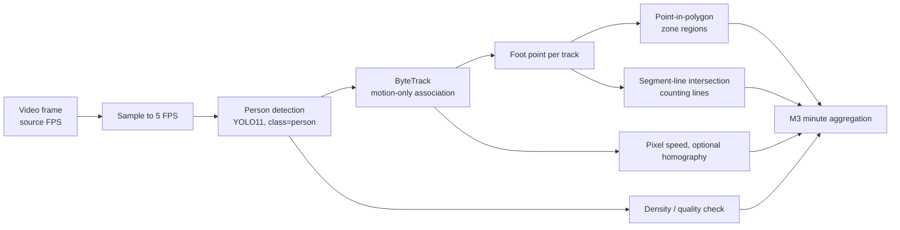

# 09 — Computer Vision Methodology

| Field | Value |
|---|---|
| Version | 0.1 |
| Status | Proposed; no CV accuracy has been measured yet |
| Module | M1, M2, M3 |

---

## 1. Goal and output contract

The CV pipeline converts video into, per zone $i$ and minute $t$:

- $N_i(t)$ — estimated occupancy,
- $F^{in}_i(t), F^{out}_i(t)$ — persons per minute crossing into/out of the zone,
- $v_i(t)$ — mean walking speed in m/s (only for calibrated cameras),
- a quality flag.

It does **not** output identities, faces, or individual trajectories beyond process memory.

## 2. Pipeline overview

## 3. Frame extraction (M1)

- Default processing rate **5 FPS**. Walking pedestrians move ≈ 1–1.5 m/s, i.e. ≈ 0.2–0.3 m between processed frames — small enough for IoU-based association and for detecting line crossings.
- Frame timestamps derive from frame index and source FPS (deterministic for recorded files), mapped to event time by a configured offset. This avoids clock drift between cameras in replay.
- Resolution: frames resized by the detector to `imgsz=640` (default) or `960` for distant cameras (slower, better small-person recall). Selected per camera after a quick calibration test.

## 4. Person detection — model comparison

| Approach | Examples | Strengths | Weaknesses | Suitable density |
|---|---|---|---|---|
| One-stage detector | YOLO11 n/s/m [13], YOLOX | Real time on modest GPU; boxes enable tracking | Misses heavily occluded / tiny people | Sparse → moderate |
| Two-stage detector | Faster R-CNN | Better small-object recall in some settings | Slower; heavier | Sparse → moderate |
| Transformer detector | RT-DETR | No NMS; good accuracy | Heavier; less tooling for students | Moderate |
| Head detector (fine-tuned on CrowdHuman heads [18]) | YOLO trained on head boxes | Heads are less occluded than bodies | Requires fine-tuning effort | Moderate → dense |
| Density map regression | CSRNet [2], DM-Count [7] | Robust count in dense crowds | No individuals → no tracking or flows | Dense → very dense |
| Point localisation | P2PNet [8] | Count + locations in dense crowds | Point tracking less mature | Dense |

### Decision CV-01 — Starting approach

| Item | Content |
|---|---|
| Selected | **YOLO11n/s pretrained on COCO, person class only**, ByteTrack tracking. Density-map model (pretrained CSRNet or DM-Count) as an optional *Could* fallback for zones flagged dense |
| Alternatives | Head detector fine-tuning; density-only pipeline; P2PNet |
| Reason | Fastest route to both counts **and** flows; no training required; adequate at college-event densities for elevated cameras (assumption to be verified in week 3) |
| Trade-offs | Undercounts in dense scenes — explicitly measured by density band ([16 §2](16_MODEL_EVALUATION.md)). Fine-tuning is deferred unless measured error requires it |

> **Important limitation.** Ordinary object detection becomes unreliable in extremely dense crowds: bodies overlap, only heads are visible, and people occupy a few pixels. In such conditions detector counts are systematically low and tracks fragment. Counts from the detector in dense windows must be treated as **lower bounds** and flagged `LOW_CONFIDENCE`.

## 5. Multi-object tracking

- **ByteTrack** [16]: Kalman filter on box state, two-stage association (high-score detections first, then low-score detections to rescue occluded tracks). No appearance embedding → no biometric-like feature vectors (privacy, [19](19_SECURITY_AND_PRIVACY.md)).
- Parameters (starting values, to tune on our footage): high threshold 0.5, low threshold 0.1, match IoU 0.8, `track_buffer` 30 frames (6 s at 5 FPS).
- Track ID switches inflate crossing counts only if a switched track crosses a line twice; mitigated by debounce (§6.2).

## 6. Zone assignment and counting

### 6.1 Occupancy (per frame)

For each camera $c$ and zone region polygon $P_{c,i}$ (in image pixels):

$$
n_{c,i}(\tau) = \big|\{ k : \text{foot}(b_k(\tau)) \in P_{c,i}\}\big|
$$

where $b_k(\tau)$ is track $k$'s box at frame $\tau$ and $\text{foot}(b) = (x_{centre}, y_{bottom})$. Foot points are used because zones are regions **on the ground plane**; box centres would assign tall people near a boundary to the wrong zone.

Per minute: $N^{cv}_i(t) = \text{median}_{\tau \in t}\, n_{c^*,i}(\tau) / \kappa_{c^*,i}$, where $c^*$ is the zone's primary camera and $\kappa \in (0,1]$ its estimated **coverage fraction** (visible share of the zone's usable area, estimated once from the floor plan). Coverage correction assumes uniform density in the unseen part — a stated assumption that can fail.

### 6.2 Flows (line crossings)

Each connection $(j \to i)$ between zones observed by a camera is represented by a counting line $\ell = (p_1, p_2)$ with a positive side assigned to zone $i$. For each track, the segment between consecutive foot points $\text{foot}_k(\tau-1) \to \text{foot}_k(\tau)$ is tested for intersection with $\ell$; the sign of the 2-D cross product gives direction.

Debounce rules:
1. A crossing is registered only when the foot point moves **beyond a band** of ±10 px around the line (prevents jitter double-counts).
2. A track can register at most one crossing per line per direction within 10 s.
3. A crossing in the opposite direction within 10 s cancels the previous one (person stepping back).

Then $F^{in}_i(t) = \sum_{\ell \in \partial i} \text{crossings into } i$ and similarly $F^{out}_i(t)$.

### 6.3 Speed (optional)

With a planar homography $H_c$ estimated from ≥ 4 measured floor points (OpenCV `findHomography`), the foot point maps to metres; speed is the displacement over 1 s, averaged over tracks in the zone. Without calibration, $v_i$ is `null` and the forecasting model uses the feature-group variant without speed ([10 §5](10_ML_FORECASTING_METHODOLOGY.md)).

## 7. Handling occlusion and high density

| Mechanism | Purpose |
|---|---|
| Elevated camera placement (≥ 3 m, angled down) recommended in recording protocol | Reduces mutual occlusion |
| ByteTrack low-score association | Keeps occluded people tracked |
| Median over 300 frames per minute | Suppresses transient misses |
| **Density flag:** window flagged dense if mean detections per region > $\delta_{max}$ (default 40) **or** median box height < 25 px | Marks counts as lower bounds |
| Optional density-map counter on flagged regions | Better counts when tracking is infeasible; flows then come only from lines in less dense areas |
| Conservation fusion ([10 §3.3](10_ML_FORECASTING_METHODOLOGY.md)) | Combines occupancy and flow estimates so that neither alone dominates |

Thresholds $\delta_{max}$ and 25 px are initial engineering guesses, to be calibrated on annotated frames.

## 8. Multiple video sources and double-counting

| Problem | Rule adopted |
|---|---|
| A zone visible to two cameras | Exactly one camera is **primary** for occupancy of that zone; overlapping parts of other cameras' regions are excluded when drawing polygons |
| A person crossing a boundary visible in two cameras | Each connection is counted by **exactly one line on one camera** (DB constraint: `counting_lines.connection_id` unique — [13](13_DATABASE_DESIGN.md)) |
| A person moving from camera A's view to camera B's view inside one zone | Occupancy uses only the primary camera ⇒ no double count; but people outside the primary view are covered only through $\kappa$ |
| Cross-camera identity | **Not attempted** (no re-identification, for privacy and complexity). Track IDs are camera-local and ephemeral |
| Zones with no camera | Marked `unobserved`; occupancy estimated only by flow integration from neighbouring lines (if any) and flagged |

Ground-plane multi-camera fusion (projecting all detections to a common floor plan and de-duplicating by position) is future work ([20](20_LIMITATIONS_AND_FUTURE_WORK.md)).

## 9. Processing budget

| Configuration | Expected behaviour (to be benchmarked; not measured) |
|---|---|
| `yolo11n`, 640 px, GPU (≥ 6 GB) | Real time for ≥ 2 streams at 5 FPS is the target (NFR-PERF-03) |
| `yolo11s`, 960 px, GPU | Better recall for distant people; fewer streams |
| CPU only | Likely below real time; process recordings offline and replay observations |

## 10. CV validation plan (summary)

- Annotate ≥ 300 frames from our own footage (point per head; tool: CVAT or Label Studio) across density bands.
- Annotate ≥ 60 min of line crossings (manual tally per 1-min bucket).
- Optionally evaluate tracker on a few MOT20 sequences [17] for reference.
- Metrics: [16 §2](16_MODEL_EVALUATION.md).

## 11. Licences

Ultralytics YOLO11 is AGPL-3.0 (or enterprise) [13]. For an academic open-source repository this is acceptable if CROWDCAST source is published under an AGPL-compatible licence. If the team or institution cannot accept AGPL, use YOLOX (Apache-2.0) with ByteTrack from `supervision` (MIT); the M2 `PersonDetector` interface isolates this choice.
