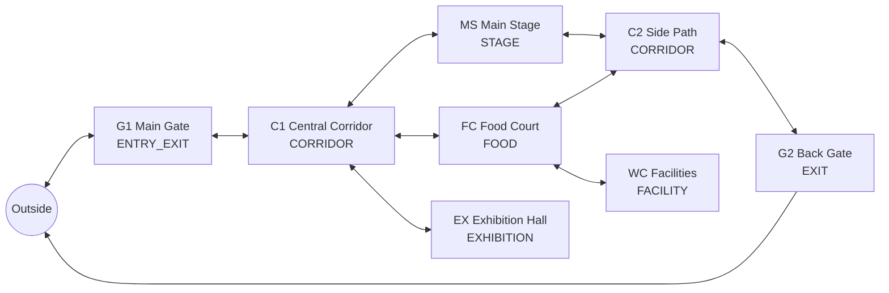

# 11 — Spatial Intelligence

| Field | Value |
|---|---|
| Version | 0.1 |
| Status | Proposed |
| Module | M5 Venue Graph (+ M7 thresholds) |

---

## 1. Venue representation

A venue is partitioned into **zones** — areas that are (a) operationally meaningful to organisers and (b) separable by observable boundaries. Zones are the nodes of a directed graph:

$$
G = (V, E), \qquad V = \{1, \dots, n\} \cup \{\omega\}, \qquad E \subseteq V \times V
$$

where $\omega$ is a virtual **outside** node connecting entry/exit zones to the world. An edge $(j, i) \in E$ means pedestrians can move directly from zone $j$ to zone $i$. Bidirectional passages are two directed edges.

## 2. Zone attributes

| Attribute | Symbol | Type | Notes |
|---|---|---|---|
| Zone ID | $i$ | integer PK | Internal |
| Zone code | — | short string, e.g. `MS` | Unique per venue; used in CSV import |
| Zone name | — | string | "Main Stage" |
| Zone type | — | enum | `STAGE`, `CORRIDOR`, `FOOD`, `ENTRY`, `EXIT`, `ENTRY_EXIT`, `SEATING`, `EXHIBITION`, `FACILITY`, `OPEN_AREA`, `OTHER` |
| Estimated usable area | $A_i$ | m² | Excludes stages, stalls, barriers |
| Maximum planning capacity | $C_i$ | persons | Supplied by organiser or $\lfloor A_i\rho_{plan}\rfloor$ |
| Current estimated occupancy | $N_i(t)$ | persons | From latest observation (not stored on the zone row — derived) |
| Connected zones | $\mathcal N^{in}(i), \mathcal N^{out}(i)$ | sets | From `zone_connections` |
| Entry/exit boundaries | $\partial i$ | set of counting lines | Each mapped to one connection and camera |
| Floor-plan polygon | $P_i$ | list of (x, y) | Plan coordinates for the UI |
| Threshold overrides | $\theta_i$ | optional | §4 |

## 3. Edge attributes

| Attribute | Symbol | Unit | Use |
|---|---|---|---|
| Boundary width | $w_{ji}$ | m | Capacity of the passage; weights neighbour features |
| Typical travel time | $\tau_{ji}$ | s | Propagation lag in features and simulator |
| Max flow rate | $q^{max}_{ji} = w_{ji}\, q_s$ | persons/min | Simulator capacity; $q_s$ = specific flow (persons/m/min), configurable |
| Directionality | — | bool | One-way passages (e.g. exit-only gates) |

## 4. Density, capacity and congestion levels

Occupancy ratio: $u_i(t) = N_i(t)/C_i$. Density: $\rho_i(t) = N_i(t)/A_i$ (persons/m²).

Default thresholds (configurable per zone, FR-ZON-06):

| Level | Condition | Colour + icon (UI) |
|---|---|---|
| NORMAL | $u < 0.60$ | green, ● |
| ELEVATED | $0.60 \le u < 0.80$ | amber, ▲ |
| HIGH | $0.80 \le u < 0.95$ | orange, ◆ |
| CRITICAL | $u \ge 0.95$ | red, ■ |

**Why ratios to planning capacity rather than fixed density values:** safe densities depend on the activity (standing audience vs moving corridor), local regulation and venue design. Level-of-service literature [31], [32] provides guidance, but CROWDCAST deliberately lets the organiser encode it in $C_i$ instead of hard-coding densities the team cannot validate. The UI also displays $\rho_i$ so operators can apply their own judgement.

The default $\rho_{plan}$ used when capacity is not supplied is a venue setting with **no built-in "safe" value**; the configuration form requires the organiser to enter it and shows a note that it must follow local guidance.

## 5. Graph-based flow relations

### 5.1 Flow decomposition

For each edge, $F_{j\to i}(t)$ is the number of people crossing from $j$ to $i$ during bucket $t$. Then

$$
F^{in}_i(t) = \sum_{j \in \mathcal N^{in}(i)} F_{j \to i}(t), \qquad F^{out}_i(t) = \sum_{k \in \mathcal N^{out}(i)} F_{i \to k}(t)
$$

and conservation for the whole venue: $\sum_{i \ne \omega} N_i(t+1) - N_i(t) = F_{\omega \to \cdot}(t) - F_{\cdot \to \omega}(t)$ (total entries minus exits). This identity is a useful **consistency check** on CV data: large violations indicate missed boundaries or counting errors.

### 5.2 Routing shares

Define the outflow share $\pi_{j\to i}(t) = F_{j\to i}(t) / F^{out}_j(t)$. Arranged as a matrix $\Pi(t)$, a first-order propagation model is

$$
\mathbf F^{in}(t+\tau) \approx \Pi(t)^{\top}\, \mathbf F^{out}(t)
$$

i.e. people leaving upstream zones arrive downstream after the travel time. CROWDCAST estimates average shares $\bar\pi_{j\to i}$ from training data and uses them in the feature `nbr_out_pressure` ([10 §5.4](10_ML_FORECASTING_METHODOLOGY.md)). This is the explicit mechanism by which a stage release becomes a forecast signal for the corridor.

### 5.3 Adjacency matrices for models

| Matrix | Definition | Used by |
|---|---|---|
| Binary $A$ | $A_{ji} = 1$ if $(j,i)\in E$ | Neighbour aggregates |
| Width-weighted $A^w$ | $A^w_{ji} = w_{ji}/\max w$ | Weighted neighbour mean |
| Normalised $\hat A$ | $\tilde D^{-1/2}(A+I)\tilde D^{-1/2}$ | GNN extension [47] |
| Transition $\bar\Pi$ | Estimated routing shares | Outflow pressure feature; simulator |

## 6. Example venue (reference topology V1 — college festival)

| Code | Type | $A_i$ (m², illustrative) | $C_i$ (illustrative) |
|---|---|---|---|
| G1 | ENTRY_EXIT | 300 | 450 |
| C1 | CORRIDOR | 400 | 500 |
| MS | STAGE | 2,000 | 3,000 |
| FC | FOOD | 800 | 900 |
| EX | EXHIBITION | 600 | 600 |
| C2 | CORRIDOR | 250 | 300 |
| G2 | EXIT | 200 | 300 |
| WC | FACILITY | 100 | 80 |

Values are illustrative for design and simulation only — not recommendations.

Synthetic topologies V2 (concert/stadium: radial concourse) and V3 (exhibition: grid of halls, held out for cross-venue testing) are described in [12 §5](12_DATASET_AND_DATA_COLLECTION.md).

## 7. Is a graph neural network justified?

| Consideration | Assessment |
|---|---|
| Graph size | 6–15 nodes. A GNN's advantage on traffic networks is shown on hundreds of nodes [20]–[22] |
| Data volume | Hours per event; tens of mostly synthetic events — small for deep models |
| Known structure | The graph is fully known and small; propagation can be expressed directly via lagged neighbour features and routing shares |
| Interpretability | Feature-based XGBoost supports feature importance and SHAP-style attribution; operators and examiners can understand why a corridor is flagged |
| **Conclusion** | Use **graph-derived features** in the main model (A4). A GNN is an optional extension (A5) to test whether learned message passing adds value beyond these features. Not a core requirement |

## 8. Route recommendations (later-stage feature)

Not in the initial requirements. Design sketch for future work: given predicted ratios $\hat u_j(t+h)$, define edge cost

$$
c_{ji}(t) = \tau_{ji}\,\big(1 + \beta\,\max(0, \hat u_i(t+h) - \theta_E)\big)
$$

and compute shortest paths (Dijkstra) from a zone to a destination type (e.g. nearest `EXIT`). Recommendations would be shown to operators (for steward direction), not the public. Open problems: recommendations change crowd behaviour (feedback loop) and can move congestion elsewhere; they require evaluation by simulation before any use.

## 9. Graph validation rules (FR-ZON-05)

1. Every zone has degree ≥ 1.
2. Every zone is reachable from $\omega$ and can reach $\omega$ (otherwise people could not enter/leave).
3. Every edge has $w > 0$ and $\tau > 0$.
4. Warning (not error) when an edge has no counting line — its flows are unobserved.
