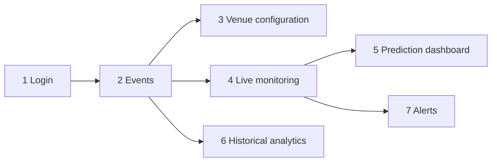

# 15 — Frontend Specification

| Field | Value |
|---|---|
| Version | 0.2 (**§7 lists the solo implementation and wins over §1–§6**) |
| Module | M9 |
| Stack | React 18, TypeScript (strict), Vite, React Router, TanStack Query, Recharts, Tailwind CSS, Radix-based components (shadcn/ui pattern) |

---

## 1. Design principles

1. **Operational clarity over decoration.** The live screen must answer, in this order: *Which zone is at risk? How soon? How sure are we?*
2. **Severity never relies on colour alone** (FR-DSH-08): every level has a colour, an icon shape and a text label.
3. **Uncertainty is visible.** Forecasts are always shown with their P10–P90 band, and a "fallback" badge when produced by persistence.
4. **Provenance is visible.** A persistent banner shows `SYNTHETIC DATA` for synthetic events; zone tiles show stale/low-confidence states.
5. **Dense but calm.** Dark theme is the default on LIVE pages (control-room use); light theme available.

## 2. Design system

### 2.1 Tokens

| Token | Light | Dark | Use |
|---|---|---|---|
| `--bg` | #F7F8FA | #0F1217 | Page background |
| `--surface` | #FFFFFF | #171B22 | Cards, panels |
| `--border` | #E2E5EA | #2A303A | Dividers |
| `--text` | #1A1D23 | #E7EAF0 | Primary text |
| `--text-muted` | #5B6270 | #9AA3B2 | Secondary text |
| `--accent` | #2F5BEA | #6E8DFF | Links, selection |
| `--lvl-normal` | #2E7D32 | #4CAF50 | NORMAL ● |
| `--lvl-elevated` | #B7791F | #E0A43A | ELEVATED ▲ |
| `--lvl-high` | #D2551E | #FF7A3D | HIGH ◆ |
| `--lvl-critical` | #C62828 | #FF5252 | CRITICAL ■ |
| `--unknown` | #808A9C | #6B7385 | No/stale data (hatched) |

Level colours must reach ≥ 3:1 contrast against surfaces (WCAG 2.1 SC 1.4.11) and are always paired with icons. Hex values are starting points, adjusted after contrast testing.

*Contrast test 2026-11-21 (WCAG relative luminance; the ratios below are recomputed from `tokens.css` by `frontend/src/theme/tokens.test.ts`):* every level colour reaches ≥ 3.4:1 on `--surface` and `--bg` in both modes, so they are used for **marks only** (icons, fills, bars); text uses `--text` / `--text-muted`. Light `--unknown` failed on `--bg` (2.88:1) and was darkened #8A94A6 → #808A9C (3.28:1). Added token `--synthetic` (#6D4BD1 / #A48BFF) for the synthetic-data banner. Typeface Inter is self-hosted (`@fontsource-variable/inter`, OFL-1.1) so the dashboard needs no external font service.

### 2.2 Typography and spacing

- Inter for UI; tabular numerals for counts so digits do not jump on refresh.
- Type scale 12 / 14 / 16 / 20 / 24 / 32 px; base 14 px on dashboards.
- 4-px spacing scale; card padding 16 px; grid gutter 16 px.

### 2.3 Core components

| Component | Description |
|---|---|
| `LevelBadge` | Icon + label + colour for a level |
| `ZoneCard` | Name, occupancy / capacity, ratio bar, level badge, 5-min trend arrow, inflow/outflow, staleness |
| `VenueMap` | SVG floor plan; zone polygons filled by level (now or selected horizon); edges drawn with thickness ∝ current flow; hover tooltip; click selects zone |
| `DensityHeatmap` | Map mode: zone fill encodes persons/m² on a sequential single-hue scale with legend (zone-level, not pixel-level) |
| `HorizonSelector` | Segmented control: Now / +5 / +15 / +30 min |
| `ForecastChart` | Observed occupancy (last 60 min), P50 points at +5/+15/+30, shaded P10–P90 band, threshold lines, "now" marker, schedule bands |
| `ForecastTimeline` | Zones × (now, +5, +15, +30) strip of predicted levels — the "what is coming" overview |
| `AlertList` / `AlertItem` | Sorted by level then onset; acknowledge/resolve; relative time ("in 12 min") |
| `ScheduleStrip` | Horizontal schedule timeline with now marker |
| `DataTable` | Sortable/filterable table |
| `PolygonEditor` | Click-to-place vertices on floor plan or camera snapshot; drag to edit |
| `EmptyState`, `ErrorState`, `Skeleton` | Standard states for every data view |

## 3. Navigation and pages



Top bar: event selector, status chip, event clock, data-origin banner, user menu. Left nav: Events, Venues, Live, Predictions, History, Alerts (+ Admin: Users, Cameras, Models).

### Page 1 — Login (`/login`)
Email, password, submit; generic error ("Email or password is incorrect"). After login → `/events`. Expired session redirects back with a notice.

### Page 2 — Event management (`/events`, `/events/:id`)
- Table: name, venue, start/end, status, synthetic flag; create/edit dialog (FR-EVT-01).
- Detail tabs: **Overview** (status transitions with confirmation), **Schedule** (table + `ScheduleStrip`; item form: zone, category, times, expected attendance, attraction weight), **Operators**, **Model** (active model; admin can change).

### Page 3 — Venue configuration (`/venues/:id`)
- Floor-plan upload; `PolygonEditor` to draw zones; side-panel form (code, name, type, area, capacity, thresholds).
- Connections: pick two zones on the map → width, travel time, bidirectional.
- Graph validation panel (FR-ZON-05).
- Cameras (ADMIN): register camera, upload snapshot, draw regions and counting lines, set primary camera and coverage fraction.

### Page 4 — Live monitoring (`/events/:id/live`) — primary operator screen

```
┌──────────────────────────────────────────────────────────────────────────┐
│ Event ▾ | LIVE ● | 14:03 event time | data: REAL | user                  │
├──────────────────────────────────────┬───────────────────────────────────┤
│ VenueMap (~60% width)                │ Active alerts                     │
│ [Now][+5][+15][+30]  [Level|Density] │ ◆ C1 predicted HIGH in 15 min     │
│ zone polygons coloured by level      │ ▲ FC ELEVATED now                 │
│ flow lines between zones             │ [Acknowledge] [Resolve]           │
├──────────────────────────────────────┴───────────────────────────────────┤
│ ForecastTimeline: zones × (now, +5, +15, +30)                            │
├──────────────────────────────────────────────────────────────────────────┤
│ ZoneCards sorted by risk score                                           │
└──────────────────────────────────────────────────────────────────────────┘
```

Covers every element in the brief: venue map, zone-wise occupancy, density heatmap (map mode), predicted occupancy (horizon selector + cards), congestion severity, forecast timeline, active alerts.

Refresh: `crowd/current` and `alerts` every 5 s, `predictions` every 10 s, paused when the tab is hidden. New OPEN alerts are highlighted briefly (no flashing above 3 Hz — WCAG 2.3.1).

### Page 5 — Prediction dashboard (`/events/:id/predictions`)
- Zone selector → `ForecastChart`.
- Table zone × horizon: P10/P50/P90, level, risk score, fallback flag, model version.
- Optional "Why?" panel (Should) with top feature attributions if stored; hidden otherwise.

### Page 6 — Historical analytics (`/events/:id/history`)
- Occupancy vs time (multi-zone) with schedule bands.
- Predicted vs actual for a chosen horizon, with period MAE computed server-side.
- Peaks per zone: max occupancy, time, minutes in HIGH/CRITICAL.
- Alert timeline vs actual episode onset (visualises lead time).
- CSV export.

### Page 7 — Alerts and notifications (`/events/:id/alerts`)
- Filters (status, level, zone, type); table with opened/acknowledged/resolved times and users.
- Detail drawer: trigger value, prediction snapshot, notes, audit trail.
- In-app toasts; optional sound on CRITICAL (FR-ALR-06). No email/SMS in core scope.

### Admin pages
Users, Cameras, Models (versions with validation metrics, activate).

## 4. States and edge cases

| Situation | UI behaviour |
|---|---|
| No data for zone | Grey hatched fill, "No data" |
| Data older than 3 min | Hatched overlay, "Stale (4 min)" |
| `LOW_CONFIDENCE` | Warning icon: "Dense scene — count may be low" |
| Prediction fallback | Badge "Persistence fallback" |
| First 15 min of event | Banner "Forecasts warming up — using persistence" |
| API unreachable | Banner "Connection lost — showing data from 14:02:10" |
| Synthetic event | Persistent banner "SYNTHETIC DATA — not a real crowd" |

## 5. Accessibility and responsiveness

- WCAG 2.1 AA target: keyboard access to all actions, visible focus, ARIA labels on map polygons (e.g. `aria-label="Central Corridor, 312 of 500, Elevated"`).
- All map information is also available in the zone-card list.
- ≥ 1280 px full layout; 768–1279 px stacked panels; < 768 px shows alerts and zone cards only.

## 6. Frontend structure

```
frontend/src/
  api/        # generated OpenAPI types + fetch wrapper (auth, error envelope)
  components/ # design-system components
  features/   # events, venues, live, predictions, history, alerts, admin
  hooks/      # useCurrent, usePredictions, useAlerts (TanStack Query)
  routes/
  theme/      # tokens.css
```

Access token kept in memory; refresh via HttpOnly cookie; route guards by role.

## 7. Solo implementation (v0.2, 9.4 audit)

Decision D1: React stack, reduced to five pages, no polygon editor; D7: no authentication. Built in WORKFLOW 4.5 and 8.1–8.6. Where this section and §1–§6 differ, this section wins.

| Topic | Design (§1–§6) | Implemented |
|---|---|---|
| Pages | Login, Events, Venue configuration, Live, Predictions, History, Alerts, Admin (Users, Cameras, Models) | Five pages under `/events/:eventId/`: **Live** (`live`), **Predictions** (`predictions`), **Alerts** (`alerts`), **History** (`history`), **Event & venue** (`event`, read-only). `/` opens the newest event; the top bar has an event selector |
| Login, roles (Page 1, §6) | Login page, in-memory token, refresh cookie, route guards | None (D7). No user menu |
| Venue configuration (Page 3), Admin pages | Polygon editor; users, cameras, model activation in the UI | Not built. Venues, events and cameras come from YAML ([12 §6](12_DATASET_AND_DATA_COLLECTION.md)); the Event & venue page shows the loaded configuration and how to change it. A model is activated through the API (`POST /api/models/{id}/activate`); the page shows which model is active |
| Predictions "Why?" panel (Page 5) | Optional, if attributions are stored | Not built (attributions are not stored) |
| History (Page 6) | Server-side MAE; alert timeline vs episode onset | MAE is computed in the browser from the timeline endpoint (same arithmetic, no API change). The alert-vs-onset view is not built; lead time is measured offline by the operational evaluation ([16 §5](16_MODEL_EVALUATION.md)) |
| Alerts (Page 7) | In-app toasts; optional sound on CRITICAL (FR-ALR-06) | Not built. Alerts appear on the Live page list and the Alerts page (filters, detail, acknowledge/resolve with an optional note) |
| Alert notes / audit trail | — | Written by the API, but no endpoint reads them back, so the UI does not show them |
| States (§4) | As specified | Built: loading, empty, error, connection-lost banner, stale forecasts, warm-up (first 15 min), all-fallback notice, SYNTHETIC banner, data origin on every page |
| Polling (AD-03) | 5–10 s | 5 s for current state and alerts, 10 s for predictions, 30 s for the event details and the per-zone forecast timeline (`src/hooks/queries.ts`) |
| Components (§2.3) | Radix-based components (shadcn/ui pattern) | Own Tailwind components (`src/components/`); no Radix or shadcn/ui dependency |
| Structure (§6) | `features/` includes events, venues, admin; fetch wrapper with auth | `features/{live,predictions,alerts,history,event}`; `api/` holds the generated OpenAPI types (`npm run gen:api`; CI fails if they drift) and an `openapi-fetch` client without auth |
| Tests | [17 §2.7](17_TESTING_STRATEGY.md) | Vitest + Testing Library: TC-FE-01 to TC-FE-05 plus page and state tests (`npm run test`) |
