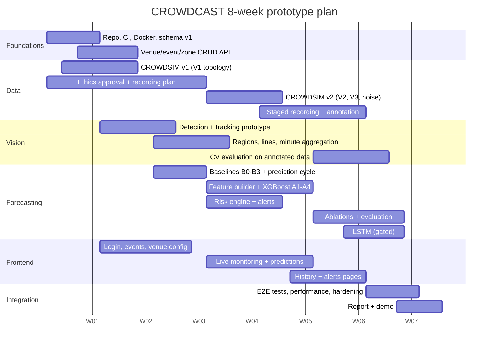

# 21 — Development Roadmap

| Field | Value |
|---|---|
| Version | 0.2 |
| Status | **Superseded for planning by [`WORKFLOW.md`](../WORKFLOW.md)** (solo scope; WORKFLOW 0.3.2). Kept as the original team plan |
| Duration | 8 weeks (weeks 1–8) + optional buffer (team plan) |
| Team | 4 members (roles in [team_responsibilities.md](../PROJECT_MANAGEMENT/team_responsibilities.md)); 3-member variant noted |

> **Solo plan.** The project is built by one developer on a CPU-only laptop, self-paced with no hard deadline (D5, started 2026-11-20). Phases, tasks, progress, decisions D1–D8 and every deviation from this roadmap are tracked in [`WORKFLOW.md`](../WORKFLOW.md); the milestone IDs MS0–MS6 are kept there. The solo scope is close to the §5 three-member variant (five pages, YAML instead of a polygon editor, LSTM as an extension), and additionally has no authentication (D7), CPU-only offline CV (YOLOX, D2) and public datasets only (D6).

Milestones are detailed in [milestones.md](../PROJECT_MANAGEMENT/milestones.md), tasks in [task_breakdown.md](../PROJECT_MANAGEMENT/task_breakdown.md).

---

## 1. Guiding rules

1. **Vertical slice first.** By end of week 3 data must flow end to end (synthetic → API → DB → baseline prediction → simple UI), even if every part is crude.
2. **Baselines before models.** Persistence and conservation baselines run before any ML model is trained.
3. **Synthetic before real.** CROWDSIM unblocks ML and UI while CV matures and recording permissions are sought.
4. **Core before extensions.** LSTM, GNN, RTSP and density maps start only when their gate criteria are met ([02 §3.2](02_OBJECTIVES_AND_SCOPE.md)).

## 2. Timeline

Dates are placeholders (8 weeks from an assumed start of 4 Jan 2027); shift to the actual start date.

## 3. Week-by-week goals

| Week | Goal | Exit criterion |
|---|---|---|
| 1 | Foundations: repo, CI, Docker Compose, DB schema v1, auth skeleton; CROWDSIM design; ethics application submitted | `docker compose up` works on all machines; migrations apply |
| 2 | CRUD for venues/zones/connections/events/schedule; CROWDSIM v1 producing V1 events; YOLO + ByteTrack running on a sample clip | Synthetic event visible as rows in DB |
| 3 | **Vertical slice (MS2):** ingestion API, persistence prediction cycle, minimal live page; regions/lines + minute aggregation in CV worker | Synthetic replay → map colours change each minute |
| 4 | Feature builder (A1–A4), XGBoost training CLI, risk engine and alerts; live page with zone cards and alert panel | First XGBoost model activated; alerts fire on synthetic surge |
| 5 | Prediction dashboard, forecast chart; CROWDSIM v2 (V2/V3, noise model); staged recording session | **MS3:** core features usable end to end |
| 6 | Annotation; CV evaluation; noise-model calibration; history and alerts pages; ablation runs started | CV metrics table filled; ablation pipeline produces tables |
| 7 | Ablation A1–A4 complete with statistics; real-data test; LSTM if gate met; performance tests | **MS4:** evaluation results available |
| 8 | Hardening, E2E tests, documentation update with real results, report and demo rehearsal | **MS5:** final demo |

Buffer: if the course allows, weeks 9–10 for A5 (GNN) or density-map extension.

## 4. Implementation priorities (first features)

1. DB schema + auth + venue/zone/event CRUD (everything depends on it).
2. CROWDSIM v1 + ingestion endpoint (unblocks all downstream work without footage).
3. Persistence prediction cycle + risk engine (gives an end-to-end alerting system before ML).
4. Live monitoring page (makes progress visible and testable).
5. CV worker: detection, tracking, regions, lines, minute aggregation.
6. XGBoost A4 with quantiles; then ablations.
7. Prediction, history and alerts pages.
8. Extensions by gate.

## 5. 3-member team variant

Merge the frontend and integration roles; reduce frontend scope to Live monitoring, Prediction, Alerts and a minimal Event/Venue form (polygon editor replaced by YAML import); drop LSTM unless ahead of schedule.

## 6. Change log

| Version | Date | Change |
|---|---|---|
| 0.2 | 2026-11-23 | Marked as superseded by `WORKFLOW.md` for planning (WORKFLOW 0.3.2) |
| 0.1 | — | Team plan |
