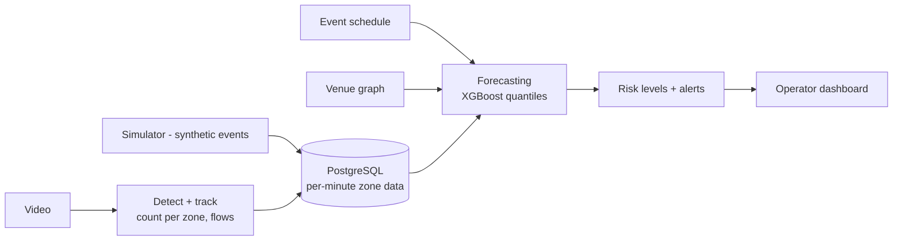

# CROWDCAST — Project Overview

| Item | Summary |
|---|---|
| Project | CROWDCAST — Event Crowd Congestion Prediction System |
| Type | College CSE project with a research component |
| Team / duration | Built by **one developer** on a CPU-only laptop, self-paced (solo scope in [`WORKFLOW.md`](WORKFLOW.md)); the original plan was 3–4 students, 6–8 weeks |
| Status | Implemented in the solo scope (Phases 1–8 done; Phase 9 report and demo in progress). Results only in [`EXPERIMENT_LOG.md`](EXPERIMENT_LOG.md) and [16 §9](DOCUMENTATION/16_MODEL_EVALUATION.md): forecasting evidence is SYNTHETIC; REAL public data is used for CV evaluation only |

## The problem in one paragraph

At festivals, concerts and exhibitions, crowds move in waves driven by the programme: when a headline act ends, the stage empties into corridors, food courts and exits. Today, monitoring is mostly reactive — operators notice congestion once it exists, which is too late for interventions that take minutes. CROWDCAST aims to forecast which zones will become congested 5–30 minutes ahead so that staff can act early.

## What the prototype will do

1. Let organisers model a venue as zones (area, capacity) connected by passages, and enter the event schedule.
2. Process recorded event video: detect and track people, count them per zone, and count crossings between zones — storing only per-minute aggregates.
3. Every minute, forecast each zone's occupancy at +5, +15 and +30 minutes with a likely range (P10–P90).
4. Classify current and predicted congestion (Normal / Elevated / High / Critical) relative to organiser-set capacity, and raise alerts with hysteresis to avoid alarm flapping.
5. Show all of this on a live operations dashboard, with history and alert management.

## How it works

## What is new (and what is not)

Crowd counting, tracking and graph-based forecasting are all established. CROWDCAST's contribution is an **empirical study at event-venue scale**: does knowing the **event schedule** and the state of **neighbouring zones** make forecasts and early warnings measurably better than forecasting each zone on its own history? The answer will be obtained through pre-planned ablation experiments (A1–A5) on synthetic events and a small set of real recordings. Either answer is a valid result.

## Key design choices

- **Simple, defensible models first.** Persistence baseline → XGBoost → LSTM; a graph neural network only if evidence justifies it.
- **Modular monolith.** One code base, three processes (API, scheduler, CV worker), one database.
- **Synthetic data with honesty.** A zone-level simulator generates training data; synthetic and real data are always labelled and reported separately.
- **Privacy by design.** No faces, no identities, no stored trajectories.

## Main risks

Detector undercounting in dense crowds; limited real data; synthetic-to-real gap; recording permissions; schedule pressure. See [PROJECT_MANAGEMENT/risk_register.md](PROJECT_MANAGEMENT/risk_register.md).

## Where to go next

[DOCUMENTATION/INDEX.md](DOCUMENTATION/INDEX.md) — navigation, notation, decisions, open questions.
